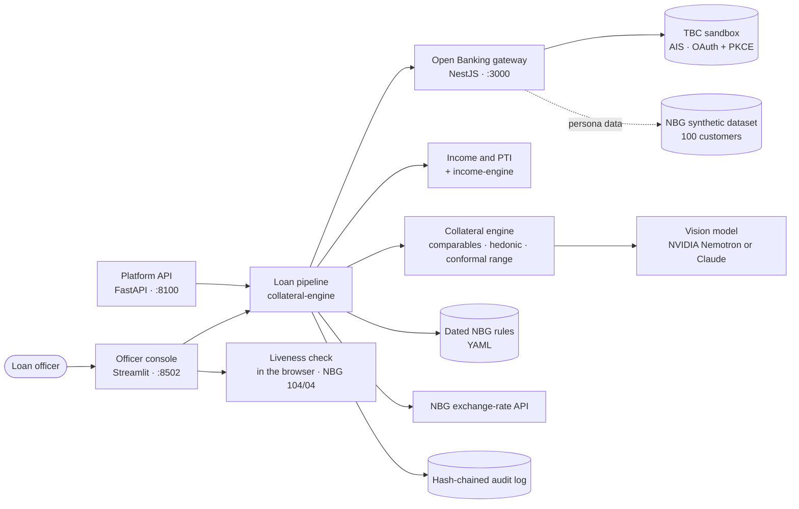

<div align="center">

<h1>🏦 Secured Lending Review</h1>

<p><em>Collateral second opinion · income from Open Banking · NBG rules · a person decides.</em><br/>
One loan application that runs the checks a Georgian loan officer does by hand before a loan is
issued, with an independent AI second opinion on the flat, house or car offered as collateral.</p>

<p>
  
  
  <a href="https://x7x-secured-lending-review.hf.space">
    
  </a>
</p>

<p>
  <a href="https://x7x-secured-lending-review.hf.space"><b>🚀 Open the officer console →</b></a>
</p>

<p>
  
  
  
  
  
  
  
</p>

</div>

---

## Demo

https://github.com/user-attachments/assets/8f0b6795-b378-41a0-bb8b-8e84c331b593

> 🎬 2 min 58 s with voice-over: one mortgage application from the customer's Open Banking consent
> to the officer's decision, then a car loan. Every product claim is shown on the real console.
> All data is synthetic; the car's exterior photos are public domain (Wikimedia Commons, CC0), its
> odometer and VIN plate are synthetic.

## Contents

- [The problem](#the-problem)
- [What it does](#what-it-does)
- [Results on synthetic data](#results-on-synthetic-data)
- [Getting started](#getting-started)
- [Demo walkthrough](#demo-walkthrough)
- [Architecture](#architecture)
- [Guardrails in code](#guardrails-in-code)
- [Georgian and NBG rules](#georgian-and-nbg-rules)
- [Environment variables](#environment-variables)
- [Third-party components and licences](#third-party-components-and-licences)
- [Limitations](#limitations)
- [Repository layout](#repository-layout)

## The problem

A loan officer at a Georgian bank receives a licensed valuer's report on the flat offered as
collateral, a salary statement and a request for a mortgage. Checking them takes hours of manual
work: the market value against comparable sales, the condition against the photos, the income
against the account history, the PTI and LTV limits of the National Bank of Georgia. Valuations are
manual, infrequent and inconsistent between banks, which distorts risk weights and provisioning.

**Who uses it:** the loan officer and the bank's valuation-quality unit, which NBG Order 84/04
Art. 1(9) separates from the valuers. **What changes:** every application gets an independent,
explained second opinion and a rule check in seconds; the officer still decides.

## What it does

- **One loan application, five checks.** Identity and watchlists, credit history, income,
  NBG affordability (PTI, term, GEL lending) and collateral (LTV), with the source and duration of
  each stage on screen.
- **Income from Open Banking.** Six months of transactions arrive through our NestJS gateway to the
  TBC sandbox after the customer's consent (OAuth 2.0 with PKCE); verified income is the median
  month, PTI uses the lower-quartile month.
- **Collateral second opinion.** Flats and private houses in Tbilisi are valued from comparable
  sales with an adjustment grid inside the NBG Order 84/04 limits, a hedonic challenger and a
  calibrated 80% range; cars are valued from earlier sales of the same model.
- **AI reads the photos.** A vision model checks the declared condition of a flat (black, white or
  green frame, renovation) and, for a car, the odometer, VIN plate, body damage and steering side.
  The model only describes; versioned rules set every status.
- **Remote identification (NBG Order 104/04).** A liveness check in the browser: three randomly
  drawn tasks (turn the head, look up, blink), a face mesh and progress ring on screen; frames are
  not stored.
- **Valuer report check.** A licensed valuer's report on any property, factories included, is
  checked article by article against Order 84/04.
- **The officer decides.** No automatic refusal; deciding against the recommendation needs a
  written reason; every assessment and decision goes to a hash-chained audit log.
- **Georgian and English** on every screen, and a numbered list of every NBG and Georgian source
  on the Overview page.

## Results on synthetic data

Out-of-time backtests (each sale valued only from sales before its date), reproduced by
`make evaluate`. The data is synthetic, so the numbers check the method and its implementation,
not real-world accuracy.

| Collateral | Sales tested | Median absolute error | Range coverage (target 80%) | COD (IAAO ≤ 15) |
|---|---|---|---|---|
| Flats | 528 | 8.4% | 77.1% | 9.7 |
| Private houses | 96 | 11.0% | 71.9% | 14.2 |
| Vehicles | 398 | 7.7% | 80.2% | – |

Vertical equity (do cheap and expensive homes get valued equally fairly): PRD 1.013 for flats,
slope of the ratio on the estimate 0.013 for flats and 0.041 for houses, gated at ±0.05.
Details in [`collateral-engine/README.md`](collateral-engine/README.md) and
[`income-engine/docs/MODEL_CARD.md`](income-engine/docs/MODEL_CARD.md).

## Getting started

### Live demo

**https://x7x-secured-lending-review.hf.space**: no login and no test credentials, all data is
synthetic. The Space runs the officer console and the Open Banking gateway together, so the TBC
sandbox consent works end to end (approve it on the sandbox page that opens in a new tab), and
the AI reads the uploaded photos. Its configuration is in [`deploy/huggingface/`](deploy/huggingface/);
the API keys are Space secrets, never in the repository.

### With Docker (recommended)

Requires Docker Desktop with about 8 GB of memory.

```bash
git clone https://github.com/Weegoos/gita-project.git
cd gita-project
docker compose up --build
```

The first build generates the synthetic markets, trains the income models and runs the test
suite inside the image, so it takes several minutes.

| Service | URL |
|---|---|
| Officer console (loan application, collateral, overview) | http://localhost:8502 |
| Platform API (Swagger) | http://localhost:8100/docs |
| Open Banking gateway (Swagger) | http://localhost:3000/api/docs |

No login or test credentials are needed: the console runs on localhost with synthetic data only.

### Without Docker

```bash
cd collateral-engine
make install    # Python 3.12 environment with both engines, pinned versions
make data       # synthetic sales and the income models (about 2 min)
make app        # console on http://localhost:8502
make api        # API on http://localhost:8100/docs (second terminal)

cd ../server
cp .env.example .env
npm ci && npm run start:dev   # gateway on http://localhost:3000 (third terminal)
```

### AI photo analysis (optional)

Without a vision provider every photo is still checked and hashed, and the condition stays
INCONCLUSIVE. To let the model read the photos, create `collateral-engine/.env` from
`.env.example` and set either:

```bash
COLLATERAL_VISION_ENABLED=true
NVIDIA_API_KEY=...                 # hosted Nemotron 3 Nano Omni (default provider)
# or
COLLATERAL_VISION_PROVIDER=anthropic
ANTHROPIC_API_KEY=...
```

### Checks

```bash
cd collateral-engine && make check                                    # 634 tests and ruff
cd server && npm run lint && npm test && npm run test:e2e && npm run build   # 460 tests
```

The same checks run in GitHub Actions ([`.github/workflows/ci.yml`](.github/workflows/ci.yml)).

## Demo walkthrough

1. Open http://localhost:8502 → **Overview** explains the flow, the quality metrics and the sources.
2. **Loan application → 1 · Applicant:** pick a customer of the NBG dataset and press **1. Request
   consent → 2. Approve at the bank → 3. Load the data** (the TBC sandbox consent page opens in a
   new tab), or **Use the bank's records** to skip the consent.
3. **2 · Remote identification:** press **Start the camera** and follow the three tasks.
4. **3 · Loan:** choose **Mortgage**, pick a demo flat (for example *Vake: appraisal above the
   market range*) and add photos.
5. **4 · Checks:** press **Run the checks**: the verdict with its reasons, the stage cards, the PTI
   and LTV limits, then the tabs **Collateral · AI analysis**, **Remote identification**,
   **Income**, **Credit history** and **Audit log** (press **Verify the hash chain**).
6. Record a decision against the recommendation: the form asks for a written reason.

## Architecture



| Component | What | Stack |
|---|---|---|
| [`collateral-engine/`](collateral-engine/README.md) | Loan pipeline, valuation of flats, houses and cars, photo checks, liveness, audit log, officer console, API | Python 3.12, FastAPI, Streamlit, pandas |
| [`income-engine/`](income-engine/README.md) | Income estimation, NBG PTI and LTV rules, explainable risk model, model card | Python 3.12, LightGBM, scikit-learn, SHAP |
| [`server/`](server/README.md) | Open Banking AIS gateway to the TBC sandbox: consents, accounts, balances, transactions | NestJS, TypeScript |
| [`data/`](data/) | Organizer dataset: 100 synthetic customers, six months of transactions | XLSX |

Every stage reports where its data came from: Open Banking, the bank's own records, or a
synthetic stand-in (Creditinfo, RS.ge, sanctions lists and the NAPR Debtors Registry are not
available to the hackathon and are labelled as stand-ins on screen).

## Guardrails in code

| Guardrail | Where |
|---|---|
| Versioned rules, not the language model, set every status | [`condition.py`](collateral-engine/src/collateral_engine/condition.py), [`config/condition_rules.yaml`](collateral-engine/config/condition_rules.yaml), [`vehicles/evidence.py`](collateral-engine/src/collateral_engine/vehicles/evidence.py) |
| Model answers off the JSON schema are discarded; a bad photo or an outage gives INCONCLUSIVE, never CONTRADICTED | [`vision.py`](collateral-engine/src/collateral_engine/vision.py), [`photos.py`](collateral-engine/src/collateral_engine/photos.py) |
| No automatic refusal; the strongest outcome is a review or a physical inspection | [`flags.py`](collateral-engine/src/collateral_engine/flags.py), [`lending/pipeline.py`](collateral-engine/src/collateral_engine/lending/pipeline.py) |
| A decision against the recommendation, and every decline, needs a written reason | [`lending/decision.py`](collateral-engine/src/collateral_engine/lending/decision.py), [`audit.py`](collateral-engine/src/collateral_engine/audit.py) |
| Append-only, hash-chained audit log; evidence photos by SHA-256 | [`audit.py`](collateral-engine/src/collateral_engine/audit.py), [`evidence.py`](collateral-engine/src/collateral_engine/evidence.py) |
| NBG values (PTI, LTV, Order 84/04 limits) only in a dated rules file, applied by the application date | [`income-engine/config/nbg_rules.yaml`](income-engine/config/nbg_rules.yaml), [`nbg_rules.py`](collateral-engine/src/collateral_engine/nbg_rules.py) |
| Comparables within Order 84/04 Art. 4(5): ≥ 3 sales, each adjustment ≤ ±15%, gross ≤ ±25% | [`comparables.py`](collateral-engine/src/collateral_engine/comparables.py), [`valuation.py`](collateral-engine/src/collateral_engine/valuation.py) |
| Two independent estimates; a large disagreement goes to review | [`valuation.py`](collateral-engine/src/collateral_engine/valuation.py), [`findings.py`](collateral-engine/src/collateral_engine/findings.py) |
| Release gates on accuracy, coverage, COD and PRD fail the build | [`tests/test_evaluation.py`](collateral-engine/tests/test_evaluation.py) |
| Liveness tasks drawn on the server, ≥ 3 and ≤ 3 attempts in 24 h; frames not stored; nothing inferred from faces | [`lending/liveness.py`](collateral-engine/src/collateral_engine/lending/liveness.py), [`app/components/liveness/`](collateral-engine/app/components/liveness/index.html) |
| No fields about honesty, emotion or biometrics in the report | [`tests/test_engine.py`](collateral-engine/tests/test_engine.py) |
| Photo metadata (GPS) stripped before leaving the bank; photos with people excluded | [`photos.py`](collateral-engine/src/collateral_engine/photos.py), [`condition.py`](collateral-engine/src/collateral_engine/condition.py) |
| Money in `Decimal`, amounts in the API as strings, limits rounded down | [`money.py`](collateral-engine/src/collateral_engine/money.py), [`ltv.py`](collateral-engine/src/collateral_engine/ltv.py) |
| Open Banking: tokens never logged, only idempotent GETs retried, errors as problem+json | [`server/src/tbc-client/`](server/src/tbc-client/), [`server/src/common/problem-details/`](server/src/common/problem-details/) |
| Income model: champion–challenger, sign checks, protected attributes only for fairness monitoring | [`income-engine/docs/MODEL_CARD.md`](income-engine/docs/MODEL_CARD.md) |

## Georgian and NBG rules

| Rule | Source |
|---|---|
| PTI 25% / 50% (GEL) and 20% / 30% (FX) around 1,500 GEL of income; thresholds of 2,000 and 2,500 GEL from 2027 | NBG Order 44/04, NBG PTI and LTV Requirements |
| LTV 90% for GEL loans secured by real estate, 70% FX, 80% FX mortgages with income from abroad | NBG Financial Stability Committee, 26 Feb 2025 |
| ≥ 3 comparables, adjustments ±15% / ±25% (±35% justified) | NBG Order 84/04 Art. 4(5) |
| Remote identification: ≥ 3 random tasks, ≤ 3 attempts in 24 hours | NBG Order 104/04 |
| Biometric data is a special category | Law of Georgia on Personal Data Protection |
| District prices per m² of new flats and houses, frame classes | Geostat Residential Property Price Index |
| Official GEL/USD rate | NBG exchange-rate API, called at run time |

All 25 sources, with links and what each one backs, are listed on the console's **Overview →
References** ([`sources.py`](collateral-engine/src/collateral_engine/sources.py)). Values taken
from press reports are marked there and must be checked against the act before production use.

## Environment variables

Every variable is optional and has a working default; each component lists its own in
`.env.example`.

| Variable | Default | Purpose |
|---|---|---|
| `COLLATERAL_VISION_ENABLED` | `false` | Let a vision model read the photos |
| `COLLATERAL_VISION_PROVIDER` | `nvidia` | `nvidia` or `anthropic` |
| `NVIDIA_API_KEY` / `ANTHROPIC_API_KEY` | none | Key of the chosen provider |
| `OPEN_BANKING_GATEWAY_URL` | `http://localhost:3000` | Where the console reaches the gateway |
| `NBG_RULES_PATH` | `income-engine/config/nbg_rules.yaml` | Dated NBG rules |
| `COLLATERAL_AUDIT_DB_PATH` | `audit.db` | Audit log |
| `TBC_API_BASE_URL`, `TBC_OAUTH_*` | see `server/.env.example` | TBC sandbox and OAuth settings |

Keys go into `.env` files, which git ignores. Full tables:
[`collateral-engine/README.md`](collateral-engine/README.md#configuration) and
[`server/README.md`](server/README.md#configuration).

## Third-party components and licences

| Component | Licence | Used for |
|---|---|---|
| FastAPI, pydantic, uvicorn, httpx, python-multipart | MIT, BSD-3-Clause, Apache-2.0 | Platform API and validation |
| Streamlit, pydeck | Apache-2.0 | Officer console and map |
| numpy, pandas, scikit-learn | BSD-3-Clause | Valuation and income models |
| LightGBM, SHAP, fairlearn | MIT | Income model, explanations, fairness monitoring |
| Pillow, PyYAML, openpyxl | MIT-CMU, MIT, MIT | Photo checks, rules, organizer dataset |
| anthropic | MIT | Claude vision client |
| MediaPipe Tasks Vision 0.10.14 and the Face Landmarker model | Apache-2.0 | Face landmarks for the liveness check, in the browser |
| NestJS, class-validator, read-excel-file | MIT | Open Banking gateway |
| reflect-metadata, rxjs, TypeScript | Apache-2.0 | Gateway runtime and build |
| pytest, ruff, vitest, oxlint, prettier | MIT | Tests, lint, format |
| NVIDIA hosted API (Nemotron 3 Nano Omni) | NVIDIA API Trial Terms; NVIDIA Open Model Agreement | Default vision model |
| Claude API | Anthropic commercial terms | Alternative vision model |
| OpenStreetMap metro stations | ODbL 1.0 | Distance to the metro |
| TBC Bank mock Open Banking sandbox, NBG dataset | Provided by the hackathon organisers | Consent and account data |
| NBG exchange-rate API, Geostat statistics | Public services and statistics | Rates and price anchors |

Exact versions and every dependency: [`collateral-engine/README.md`](collateral-engine/README.md#third-party-components),
[`server/README.md`](server/README.md#third-party-components),
[`income-engine/README.md`](income-engine/README.md#third-party-components).

## Limitations

- **All data is synthetic.** No real person, account, property or bank customer is represented.
  Real accuracy is known only after a pilot on NAPR transactions or a bank's appraisal database.
- The synthetic sales follow the same structure as the hedonic model, so the backtest checks the
  implementation, not real-world accuracy; range coverage is below target for houses.
- The vision and liveness checks have not been measured on a labelled set; their thresholds are
  set by hand.
- Credit history, RS.ge, the sanctions list and the Debtors Registry are synthetic stand-ins.
- Some NBG values come from press reports and are marked to verify (see References).
- The API does not authenticate callers; run it on localhost or a private network.

## Repository layout

```
.
├── collateral-engine/   loan pipeline, collateral valuation, liveness, console, API (Python)
├── income-engine/       income estimation, NBG rules, risk model (Python)
├── server/              Open Banking AIS gateway to the TBC sandbox (NestJS)
├── data/                organizer dataset (synthetic)
├── docker-compose.yml   the whole platform in three containers
├── CLAUDE.md            engineering rules for humans and AI agents
└── LICENSE              MIT
```

<div align="center">

Built for the **NBG AI & Open Banking Hackathon 2026** · Track 1 AI in Finance · AI1 Credit Risk &
Lending · released under the [MIT licence](LICENSE).

</div>
